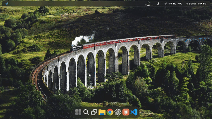
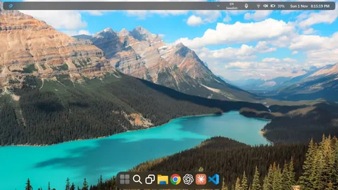
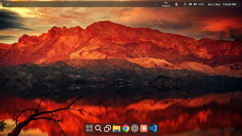

<p align="center">
  🇬🇧 <a href="README.md">English</a> · 🇫🇷 <a href="README.fr.md">Français</a> · 🇪🇸 <a href="README.es.md">Español</a>
  · 🇨🇳 <a href="README.zh-CN.md">中文</a> · 🇮🇳 <a href="README.hi.md">हिन्दी</a>
  · 🇧🇷 <a href="README.pt.md">Português</a> · 🇷🇺 <a href="README.ru.md">Русский</a> · 🇸🇦 <strong>العربية</strong>
  · 🇧🇩 <a href="README.bn.md">বাংলা</a> · 🇵🇰 <a href="README.ur.md">اردو</a>
</p>

<div dir="rtl">

<p align="center">
  <a href="https://github.com/ibrahimbouillet/AetherShell/releases/latest"><strong>تنزيل أحدث إصدار</strong></a>
  · <a href="docs/i18n/ar/USER_GUIDE.md">دليل الاستخدام</a>
  · <a href="KNOWN_LIMITATIONS.md">القيود المعروفة (بالإنجليزية)</a>
  · <a href="docs/knowledge/TEST_STATUS.md">نتائج الاختبارات (بالإنجليزية)</a>
</p>

</div>

<p align="center">
  <a href="https://github.com/ibrahimbouillet/AetherShell/actions/workflows/ci.yml"></a>
  <a href="LICENSE"></a>
  
  <a href="https://www.youtube.com/@IbrahimBouillet"></a>
</p>



<div dir="rtl">

# Aether Shell

واجهة سطح مكتب أصلية لنظام Windows من تطوير **Ibrahim Bouillet**. يجمع Aether Shell بين Dock عائم وشريط حالة علوي مدمج،
بمادة شبه شفافة ضبابية بنعومة. وهو مكتوب بلغة C++20 باستخدام Win32 وDirect2D/DirectWrite وWindows.UI.Composition،
ويُوزَّع بموجب رخصة MIT.

> **برنامج في مرحلة ألفا:** الإصدار 0.3.5-alpha.3 (Alpha 3، الإصدار 3.5) نسخة معاينة عامة مبكرة. وهو ليس بديلًا مؤهَّلًا
> بالكامل لصَدَفة Windows. احفظ عملك قبل التجربة، واقرأ [القيود المعروفة](KNOWN_LIMITATIONS.md) (بالإنجليزية).

> **قريبًا: Alpha 4.** الإصدار التالي قيد التطوير: نمطان للاختيار بينهما، *Liquid* (زجاج مائي شفاف) و*Grain* (المادة
> المصنفرة الحالية)، وبحث يجد أيضًا صفحات إعدادات Windows والملفات والمجلدات، وواجهة بعدة لغات تتبع لغة عرض Windows لديك،
> وصَدَفة أخف وأكثر سلاسة. [تابع الإصدارات](https://github.com/ibrahimbouillet/AetherShell/releases)
> لتعرف متى يصدر.

</div>

<h2 align="center">سطح مكتب جديد. أجواء جديدة.</h2>

<p align="center">
  
</p>

<table>
  <tr>
    <td align="center" width="20%"><a href="./resources/preview/setup_preview-1.png"></a></td>
    <td align="center" width="20%"><a href="./resources/preview/setup_preview-5.webp"></a></td>
    <td align="center" width="20%"><a href="./resources/preview/setup_preview-4.webp"></a></td>
    <td align="center" width="20%"><a href="./resources/preview/setup_preview-3.webp"></a></td>
    <td align="center" width="20%"><a href="./resources/preview/setup_preview-2.png"></a></td>
  </tr>
</table>

<p align="center"><sub>Dock واحد وشريط علوي واحد يكتسبان ألوان أي خلفية تختارها. اختر صورة لتراها بالحجم الكامل.<br>
أسطح مكتب حقيقية، التُقطت على Windows 11. الخلفيات وأيقونات التطبيقات ملك لأصحابها ولا تشملها رخصة هذا المشروع.</sub></p>

<div dir="rtl">

## ما الذي يفعله

- **Dock:** تشغيل التطبيقات والتنقل بينها، والاحتفاظ بالمفضلة، وإعادة ترتيب الأيقونات المثبتة، ورؤية التطبيقات قيد
  التشغيل بعلامات متحركة ومعاينات حقيقية للنوافذ عند تمرير المؤشر، وفتح البحث، والوصول إلى «ابدأ» و«عرض المهام».
- **شريط الحالة العلوي:** يعرض الساعة ولغة الإدخال والشبكة والصوت والبطارية كما يوفرها Windows. يفتح التاريخ والوقت
  إشعارات Windows والتقويم، ويفتح السهم أيقونات منطقة الإشعارات المخفية في Windows، ويفتح إجراء الحالة المجمَّع لوحة
  الإعدادات السريعة في Aether مع قائمة شبكات Wi-Fi.
- **البحث:** العثور على التطبيقات وأدوات Windows نفسها وفتحها، مثل إدارة الأجهزة أو الخدمات أو عناصر لوحة التحكم.
- **الإخفاء التلقائي:** دع Dock والشريط العلوي، كلًّا على حدة، ينزلقان بعيدًا بينما تغطيهما نافذة تطبيق، ويعودان عندما
  يصل المؤشر إلى حافة الشاشة، للحصول على مساحة عمل بملء الشاشة.
- **عشر لغات:** الواجهة كلها، بما فيها برنامج التثبيت، بالإنجليزية والصينية والهندية والإسبانية والفرنسية والبرتغالية
  والروسية والعربية والبنغالية والأردية. وهي تتبع لغات العرض في Windows لديك، أو اللغة التي تختارها في الإعدادات ←
  اللغة، وتتذكر هذا الاختيار من إصدار إلى آخر. انظر [اللغات](#اللغات).
- **الترحيب:** تحية اختيارية مكتوبة بخط اليد بالفرنسية أو الإنجليزية أو الإسبانية فوق خلفيتك الضبابية، بعد تسجيل
  الدخول أو فتح قفل الكمبيوتر. يمكن لبرنامج التثبيت أن يسأل عن الاسم الذي تُحيّيك به.
- **الطقس:** استخدم اختياريًا إذن الموقع في Windows للحصول على موضع تقريبي وتوقعات. إذا لم يتوفر الموقع أو الشبكة،
  يبقى الطقس غير متاح بدلًا من التخمين.
- **الحركة والمظهر:** تصميم زجاجي مصنفر محايد واحد عبر الأشرطة والإعدادات والقوائم وبرنامج التثبيت؛ تمرير سلس في
  الإعدادات؛ نوافذ مكبّرة بزوايا مستديرة بينما يستبدل Aether شريط المهام؛ مظهر فاتح/داكن، والتنقل بلوحة المفاتيح،
  ودعم تقليل الحركة.
- **الاسترداد:** برنامج تثبيت لكل مستخدم، ومساعد استرداد منفصل، ودعم الإصلاح وإلغاء التثبيت، وأمر لاستعادة شريط مهام
  Windows.

## الجديد في الإصدار 3.5

لا يتدخل الإصدار 3.5 في علامات تبويب التطبيقات وأزرار إغلاقها (يستجيب الشريط العلوي لأعلى الشاشة تمامًا فقط)، ويغلق
اللوحات بمجرد أن تستخدم أي شيء آخر، ويجد أدوات Windows نفسها في البحث. أصبح الترحيب يحيّيك باسمك منذ المرة الأولى لأن
برنامج التثبيت يسأل عنه؛ ويعرض خلفيتك حتى لو نُقل ملف الصورة أو حُذف، ويعمل قلمه بجهد أقل في كل إطار. اقرأ
[ملاحظات الإصدار](docs/releases/0.3.5-alpha.3.md) و[سجل التغييرات](CHANGELOG.md) (بالإنجليزية).

## اللغات

يتحدث Aether Shell أكثر عشر لغات انتشارًا في العالم. كل قائمة ولوحة وصفحة إعدادات ورسالة وشاشة تثبيت مترجمة، وكذلك
هذه الوثائق.

| | اللغة | الواجهة | الوثائق |
|---|---|---|---|
| 🇬🇧 | English | ✅ | [README](README.md) · [User guide](USER_GUIDE.md) · [Installation](INSTALLATION.md) |
| 🇨🇳 | 中文（简体） | ✅ | [README](README.zh-CN.md) · [使用指南](docs/i18n/zh-CN/USER_GUIDE.md) · [安装](docs/i18n/zh-CN/INSTALLATION.md) |
| 🇮🇳 | हिन्दी | ✅ | [README](README.hi.md) · [उपयोग गाइड](docs/i18n/hi/USER_GUIDE.md) · [इंस्टॉलेशन](docs/i18n/hi/INSTALLATION.md) |
| 🇪🇸 | Español | ✅ | [README](README.es.md) · [Guía de uso](docs/i18n/es/USER_GUIDE.md) · [Instalación](docs/i18n/es/INSTALLATION.md) |
| 🇫🇷 | Français | ✅ | [README](README.fr.md) · [Guide d'utilisation](docs/i18n/fr/USER_GUIDE.md) · [Installation](docs/i18n/fr/INSTALLATION.md) |
| 🇧🇷 | Português | ✅ | [README](README.pt.md) · [Guia do usuário](docs/i18n/pt/USER_GUIDE.md) · [Instalação](docs/i18n/pt/INSTALLATION.md) |
| 🇷🇺 | Русский | ✅ | [README](README.ru.md) · [Руководство](docs/i18n/ru/USER_GUIDE.md) · [Установка](docs/i18n/ru/INSTALLATION.md) |
| 🇸🇦 | العربية | ✅ (من اليمين إلى اليسار) | [README](README.ar.md) · [دليل الاستخدام](docs/i18n/ar/USER_GUIDE.md) · [التثبيت](docs/i18n/ar/INSTALLATION.md) |
| 🇧🇩 | বাংলা | ✅ | [README](README.bn.md) · [ব্যবহারকারী নির্দেশিকা](docs/i18n/bn/USER_GUIDE.md) · [ইনস্টলেশন](docs/i18n/bn/INSTALLATION.md) |
| 🇵🇰 | اردو | ✅ (من اليمين إلى اليسار) | [README](README.ur.md) · [صارف گائیڈ](docs/i18n/ur/USER_GUIDE.md) · [انسٹالیشن](docs/i18n/ur/INSTALLATION.md) |

**اتباع Windows** (الافتراضي) يمرّ على لغات العرض في Windows لديك (الإعدادات ← الوقت واللغة) بالترتيب الذي رتّبتها به،
ويأخذ أولى اللغات التي تكون من هذه العشر؛ وإن لم توجد فالإنجليزية. اختر لغة أخرى من **الإعدادات ← اللغة**؛ يسري التغيير
فورًا ويُحفظ في إعداداتك التي يقرؤها كل إصدار: فتثبيت إصدار جديد أو الإصلاح أو إعادة التثبيت يُبقي اختيارك، ويتحدث
بهذه اللغة أيضًا برنامج التثبيت والمحدِّث والمشغِّل. الأسماء التي تخصّك أو تخص برامج أخرى (التطبيقات والملفات وشبكات
Wi-Fi) لا تُترجم أبدًا. يكتب الترحيب المكتوب بخط اليد بحروف لاتينية، ولذلك يحيّي بالفرنسية أو الإنجليزية أو الإسبانية.
تُقرأ العربية والأردية من اليمين إلى اليسار: يُشكَّل النص ويُحاذى وفق ذلك، بينما تحتفظ الأشرطة واللوحات بتخطيطها.
توجد الترجمات في [tools/i18n/catalog](tools/i18n/catalog)؛ والتصحيحات مرحَّب بها.

## استبدال شريط مهام Windows

تُخفي تجربة V2 شريط مهام Windows عند بدء Aether Shell ثم تعرض Dock الخاص بـ Aether مكانه. هذا السلوك مفعّل افتراضيًا
ويمكن إيقافه من **إعدادات Aether Shell ← سطح المكتب**. يواصل مستكشف الملفات (Explorer) عمله؛ ولا يستبدل Aether Shell
الملف `explorer.exe` ولا يغيّر صَدَفة Winlogon ولا يسجّل نفسه كشريط المهام الأصلي في إعدادات Windows. يستعيد مساعد
الاسترداد شريط مهام Windows عند خروج Aether Shell. اقرأ [دليل الاسترداد](docs/i18n/ar/USER_GUIDE.md) قبل تجربة نسخة ألفا.

## التنزيل والتثبيت

نزّل **ملف التثبيت التنفيذي x64** من [أحدث إصدار على GitHub](https://github.com/ibrahimbouillet/AetherShell/releases/latest)
وقارن قيمة SHA-256 الخاصة به بملف المجاميع الاختبارية للإصدار. شغّل التثبيت بصفتك مستخدم Windows العادي. يشرح برنامج
التثبيت سلوك شريط المهام ولا يتطلب صلاحيات المسؤول. يحدّد التثبيت الجديد **التشغيل عند تسجيل الدخول** بشكل ظاهر؛ ويمكنك
إلغاء هذا الخيار قبل الموافقة. وتُحترم الاختيارات المحفوظة سابقًا وحالات تعطيل بدء التشغيل من إدارة المهام. كما يتيح
برنامج التثبيت حقلًا اختياريًا للاسم الذي يحيّيك به الترحيب؛ ويبقى هذا الاسم على جهازك. يمكن للمشغِّل المثبَّت أن
يعيد المحاولة عددًا محدودًا من مرات الإخفاق غير الطبيعي؛ ويبقى «إنهاء» والاسترداد وإلغاء التثبيت متاحة. يتحكم Windows في
توقيت بدء التشغيل، لذا لا يستطيع Aether ضمان ظهور واجهته قبل شريط المهام الأصلي عند تسجيل الدخول.

تُوزَّع نسخة ألفا هذه للتثبيت اليدوي. تتطلب التحديثات التلقائية بيان إصدار موقّعًا؛ ولا يُنشر أي بيان غير موقّع. ملف
التثبيت غير موقّع بتوقيع Authenticode، لذا قد يعرض Windows تحذير SmartScreen. انظر [التثبيت والتحقق](docs/i18n/ar/INSTALLATION.md).

## التوافق

- Windows 11 بمعمارية x64: هدف التطوير الحالي.
- Windows 10 الإصدار 2004 فما فوق بمعمارية x64: مدعوم بحسب التصميم، لكنه غير مؤهَّل أثناء التشغيل في هذا الإصدار.
- ARM64: غير مؤهَّل أثناء التشغيل.

يستخدم تمويه الخلفية في Windows 10 صبغة أبسط. ولا يعيد Dock إنتاج كل ميزات شريط المهام الأصلي، وتواصل إعدادات Windows
إدارة شريط مهام Windows. انظر [القيود المعروفة](KNOWN_LIMITATIONS.md) كاملة (بالإنجليزية).

## البناء والاختبار

ابنِ على Windows باستخدام أدوات بناء Visual Studio لـ C++ وحزمة Windows SDK وCMake وNinja وPython:

</div>

<div dir="ltr">

```powershell
./scripts/build.ps1 -Config release -BuildDir build/release -Test -TestExclude 'network|integration' `
    -CMakeArgs '-DAETHER_WARNINGS_AS_ERRORS=ON'
```

</div>

<div dir="rtl">

لبناء برنامج التثبيت لكل مستخدم وتشغيل تدقيق الخصوصية وحداثة الحزمة:

</div>

<div dir="ltr">

```powershell
./scripts/package.ps1 -BuildDir build/release
```

</div>

<div dir="rtl">

انظر [BUILDING.md](BUILDING.md) للاختبارات المركّزة لكل وحدة، و[TESTING.md](TESTING.md) لعزل الاختبارات والتأهيل اليدوي،
و[سجل الاختبارات المنفَّذة](docs/knowledge/TEST_STATUS.md) للنتائج الدقيقة (كلها بالإنجليزية). نجاح عملية بناء أو مجموعة
اختبارات لا يؤهّل بمفرده كل إصدارات Windows أو كل الأجهزة.

## وثائق المشروع

- [البنية](ARCHITECTURE.md) · [مواصفات المشروع](PROJECT_SPEC.md) · [حالة المهام](TASKS.md)
- [دليل الاستخدام](docs/i18n/ar/USER_GUIDE.md) · [التثبيت](docs/i18n/ar/INSTALLATION.md) · [التحديث والتراجع](UPDATE_AND_ROLLBACK.md)
- [سياسة الأمان](SECURITY.md) · [المساهمة](CONTRIBUTING.md) · [إشعارات الجهات الخارجية](THIRD_PARTY_NOTICES.md)

للمساهمين ومساعدي البرمجة: ابدأ بـ [AGENTS.md](AGENTS.md) و[HANDOFF.md](HANDOFF.md).

## الرخصة

MIT. انظر [LICENSE](LICENSE).

</div>
