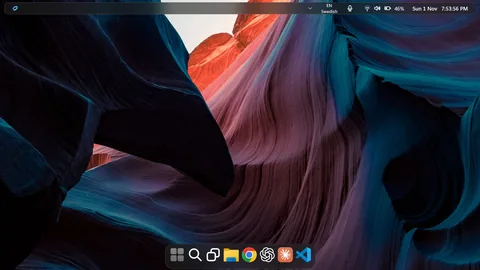

<p align="center">
  🇬🇧 <a href="README.md">English</a> · 🇫🇷 <a href="README.fr.md">Français</a> · 🇪🇸 <a href="README.es.md">Español</a>
  · 🇨🇳 <a href="README.zh-CN.md">中文</a> · 🇮🇳 <a href="README.hi.md">हिन्दी</a>
  · 🇧🇷 <a href="README.pt.md">Português</a> · 🇷🇺 <a href="README.ru.md">Русский</a> · 🇸🇦 <a href="README.ar.md">العربية</a>
  · 🇧🇩 <strong>বাংলা</strong> · 🇵🇰 <a href="README.ur.md">اردو</a>
</p>

<p align="center">
  <a href="https://github.com/ibrahimbouillet/AetherShell/releases/latest"><strong>সর্বশেষ রিলিজ ডাউনলোড করুন</strong></a>
  · <a href="docs/i18n/bn/USER_GUIDE.md">ব্যবহারকারী নির্দেশিকা</a>
  · <a href="KNOWN_LIMITATIONS.md">জানা সীমাবদ্ধতা (ইংরেজিতে)</a>
  · <a href="docs/knowledge/TEST_STATUS.md">পরীক্ষার ফলাফল (ইংরেজিতে)</a>
</p>

<p align="center">
  <a href="https://github.com/ibrahimbouillet/AetherShell/actions/workflows/ci.yml"></a>
  <a href="LICENSE"></a>
  
  <a href="https://www.youtube.com/@IbrahimBouillet"></a>
</p>


# Aether Shell

**Ibrahim Bouillet**-এর তৈরি Windows-এর একটি নেটিভ ডেস্কটপ ইন্টারফেস। Aether Shell একটি ভাসমান Dock এবং একটি
কমপ্যাক্ট উপরের স্ট্যাটাস বারকে একসাথে আনে, যাতে আছে নরমভাবে ঝাপসা ও স্বচ্ছ একটি উপাদান। এটি C++20-এ Win32,
Direct2D/DirectWrite ও Windows.UI.Composition দিয়ে তৈরি এবং MIT লাইসেন্সের অধীনে প্রকাশিত।

> **আলফা সফটওয়্যার:** 0.4.0-alpha.4 (Alpha 4) একটি প্রাথমিক পাবলিক প্রিভিউ। এটি Windows শেলের সম্পূর্ণ
> যাচাই-করা বিকল্প নয়। পরীক্ষার আগে আপনার কাজ সংরক্ষণ করুন এবং [জানা সীমাবদ্ধতা](KNOWN_LIMITATIONS.md) (ইংরেজিতে) পড়ুন।

<h2 align="center">একটি নতুন ডেস্কটপ। একটি নতুন আবহ।</h2>

<p align="center">
  
</p>

<table>
  <tr>
    <td align="center" width="20%"><a href="./resources/preview/setup_preview-1.png"></a></td>
    <td align="center" width="20%"><a href="./resources/preview/setup_preview-5.webp"></a></td>
    <td align="center" width="20%"><a href="./resources/preview/setup_preview-4.webp"></a></td>
    <td align="center" width="20%"><a href="./resources/preview/setup_preview-3.webp"></a></td>
    <td align="center" width="20%"><a href="./resources/preview/setup_preview-2.png"></a></td>
  </tr>
</table>

<p align="center"><sub>একটি Dock ও একটি উপরের বার, যা আপনার বেছে নেওয়া যেকোনো ওয়ালপেপারের রঙ নেয়। পূর্ণ আকারে দেখতে একটি ছবি বেছে নিন।<br>
Windows 11-এ তোলা আসল ডেস্কটপ। ওয়ালপেপার ও অ্যাপ্লিকেশনের আইকন তাদের মালিকদের এবং এই প্রকল্পের লাইসেন্সের আওতায় পড়ে না।</sub></p>

## এটি কী করে

- **Dock:** অ্যাপ্লিকেশন চালু করা ও এক অ্যাপ থেকে আরেকটিতে যাওয়া, প্রিয়গুলো রাখা, পিন করা আইকনের ক্রম বদলানো, হোভার করলে
  অ্যানিমেটেড মার্কার ও আসল উইন্ডো প্রিভিউসহ চলমান অ্যাপ দেখা, অনুসন্ধান খোলা এবং স্টার্ট ও টাস্ক ভিউতে পৌঁছানো।
- **উপরের স্ট্যাটাস বার:** Windows থেকে পাওয়া ঘড়ি, ইনপুট ভাষা, নেটওয়ার্ক, অডিও ও ব্যাটারির অবস্থা দেখায়। তারিখ ও সময়
  Windows-এর বিজ্ঞপ্তি ও ক্যালেন্ডার খোলে, একটি তীর Windows-এর লুকানো নোটিফিকেশন-এলাকার আইকন খোলে, আর গোষ্ঠীবদ্ধ স্ট্যাটাস
  অ্যাকশন Aether-এর দ্রুত সেটিংস প্যানেল খোলে, যার মধ্যে Wi-Fi-এর তালিকাও আছে।
- **অনুসন্ধান:** অ্যাপ্লিকেশন এবং Windows-এর নিজস্ব টুল, যেমন ডিভাইস ম্যানেজার, সার্ভিস বা কন্ট্রোল প্যানেলের আইটেম, খুঁজে খোলা।
- **স্বয়ংক্রিয় লুকানো:** কোনো অ্যাপ্লিকেশন উইন্ডো ঢেকে দিলে Dock ও উপরের বারকে, প্রত্যেকটিকে আলাদাভাবে, সরে যেতে দিন এবং
  পয়েন্টার পর্দার প্রান্তে পৌঁছালে ফিরে আসতে দিন, পূর্ণ-পর্দার কর্মক্ষেত্রের জন্য।
- **41টি ভাষা:** সেটআপসহ পুরো ইন্টারফেস Windows 11-এর দেওয়া 38টি ভাষায়, সঙ্গে বাংলা, হিন্দি ও উর্দুতে। এটি আপনার
  Windows ডিসপ্লে ভাষা অনুসরণ করে, অথবা আপনি সেটিংস → ভাষায় যেটি বেছে নেন সেটি, এবং সেই পছন্দ এক সংস্করণ থেকে আরেক
  সংস্করণে মনে রাখে। প্রতিটি ভাষা দরকার হলে রিলিজ থেকে ডাউনলোড করা হয়। দেখুন [ভাষা](#ভাষা)।
- **স্বাগতম:** আপনি সাইন ইন বা পিসি আনলক করার পর আপনার ঝাপসা ওয়ালপেপারের ওপর ফরাসি, ইংরেজি বা স্প্যানিশে হাতে লেখা একটি
  ঐচ্ছিক অভিবাদন। সেটআপ জিজ্ঞেস করতে পারে কী নামে সে আপনাকে অভিবাদন জানাবে।
- **আবহাওয়া:** ঐচ্ছিকভাবে আনুমানিক অবস্থান ও পূর্বাভাসের জন্য Windows-এর লোকেশন অনুমতি ব্যবহার করুন। লোকেশন বা নেটওয়ার্ক
  না থাকলে আবহাওয়া অনুমান না করে অনুপলব্ধই থাকে।
- **গতি ও চেহারা:** বার, সেটিংস, মেনু ও সেটআপ জুড়ে একটিই নিরপেক্ষ ঘষা-কাচের নকশা; মসৃণ সেটিংস স্ক্রল; Aether টাস্কবার
  প্রতিস্থাপন করার সময় বড় করা উইন্ডোর গোলাকার কোণ; গাঢ়/হালকা চেহারা, কীবোর্ডে চলাচল ও কম-গতির সমর্থন।
- **পুনরুদ্ধার:** প্রতি-ব্যবহারকারী ইনস্টলার, আলাদা পুনরুদ্ধার সহায়ক, মেরামত/আনইনস্টলের সমর্থন এবং Windows টাস্কবার
  ফিরিয়ে আনার একটি কমান্ড।

## Alpha 4-এ নতুন কী

দুটি স্টাইল: *Liquid*, আপনার নিজের মতো করে সাজানো একটি ঝাপসা স্তরের ওপর স্বচ্ছ জলের মতো কাচ, এবং *Grain*, আগের
সংস্করণগুলোর ঘষা কাচের উপাদান। Liquid-এ সেটিংস উইন্ডো শুধু নিজের লেখা ও কন্ট্রোলের নিচের অংশটুকু ঝাপসা করে, বাকি সব জায়গায়
স্বচ্ছ থাকে। ইন্টারফেস 41টি ভাষায় কথা বলে, যেগুলো দরকার হলে রিলিজ থেকে ডাউনলোড হয়, এবং আপনার Windows ডিসপ্লে ভাষা অনুসরণ
করে। স্টার্ট নাম দিয়ে যা খুঁজে পায়, অনুসন্ধানও তা খুঁজে পায়। আবহাওয়া এখন নিখুঁত ও অ্যানিমেটেড, আর তার নিজস্ব একটি উইন্ডো
আছে। উপরের বার আপনার ডেস্কটপের ওপর শুধু সাদামাটা লেখা হিসেবেও থাকতে পারে, টেনে নেওয়া আইকন Dock-কে প্রসারিত করে, আর সাইন
ইন করার পর Aether আরও তাড়াতাড়ি চালু হয়। পড়ুন [রিলিজ নোট](docs/releases/0.4.0-alpha.4.md) ও
[পরিবর্তনের তালিকা](CHANGELOG.md) (ইংরেজিতে)।

## ভাষা

Aether Shell-এর ইন্টারফেস 41টি ভাষায় কথা বলে: Windows 11-এর দেওয়া 38টি ভাষা, সঙ্গে বাংলা, হিন্দি ও উর্দু। প্রতিটি মেনু,
প্যানেল, সেটিংস পেজ, বার্তা ও সেটআপ পর্দা অনূদিত। Aether আপনার Windows ডিসপ্লে ভাষা অনুসরণ করে, অথবা আপনি সেটিংস → ভাষায়
যেটি বেছে নেন সেটি; প্রতিটি ভাষা দরকার হলে রিলিজ থেকে ডাউনলোড করা হয়। এই নথিপত্র নিচের দশটি ভাষায় আছে।

| | ভাষা | ইন্টারফেস | নথিপত্র |
|---|---|---|---|
| 🇬🇧 | English | ✅ | [README](README.md) · [User guide](USER_GUIDE.md) · [Installation](INSTALLATION.md) |
| 🇨🇳 | 中文（简体） | ✅ | [README](README.zh-CN.md) · [使用指南](docs/i18n/zh-CN/USER_GUIDE.md) · [安装](docs/i18n/zh-CN/INSTALLATION.md) |
| 🇮🇳 | हिन्दी | ✅ | [README](README.hi.md) · [उपयोग गाइड](docs/i18n/hi/USER_GUIDE.md) · [इंस्टॉलेशन](docs/i18n/hi/INSTALLATION.md) |
| 🇪🇸 | Español | ✅ | [README](README.es.md) · [Guía de uso](docs/i18n/es/USER_GUIDE.md) · [Instalación](docs/i18n/es/INSTALLATION.md) |
| 🇫🇷 | Français | ✅ | [README](README.fr.md) · [Guide d'utilisation](docs/i18n/fr/USER_GUIDE.md) · [Installation](docs/i18n/fr/INSTALLATION.md) |
| 🇧🇷 | Português | ✅ | [README](README.pt.md) · [Guia do usuário](docs/i18n/pt/USER_GUIDE.md) · [Instalação](docs/i18n/pt/INSTALLATION.md) |
| 🇷🇺 | Русский | ✅ | [README](README.ru.md) · [Руководство](docs/i18n/ru/USER_GUIDE.md) · [Установка](docs/i18n/ru/INSTALLATION.md) |
| 🇸🇦 | العربية | ✅ (ডান থেকে বামে) | [README](README.ar.md) · [دليل الاستخدام](docs/i18n/ar/USER_GUIDE.md) · [التثبيت](docs/i18n/ar/INSTALLATION.md) |
| 🇧🇩 | বাংলা | ✅ | [README](README.bn.md) · [ব্যবহারকারী নির্দেশিকা](docs/i18n/bn/USER_GUIDE.md) · [ইনস্টলেশন](docs/i18n/bn/INSTALLATION.md) |
| 🇵🇰 | اردو | ✅ (ডান থেকে বামে) | [README](README.ur.md) · [صارف گائیڈ](docs/i18n/ur/USER_GUIDE.md) · [انسٹالیشن](docs/i18n/ur/INSTALLATION.md) |

**Windows অনুসরণ করুন** (ডিফল্ট) আপনার Windows ডিসপ্লে ভাষাগুলো (সেটিংস → সময় ও ভাষা) আপনার সাজানো ক্রমে দেখে এবং সেগুলোর
মধ্যে প্রথম যে ভাষাটি Aether Shell বলে (41টির যেকোনোটি) সেটি নেয়; কোনোটিই না থাকলে ইংরেজি। **সেটিংস → ভাষায়** অন্য একটি
বেছে নিন; পরিবর্তন সঙ্গে সঙ্গে প্রযোজ্য হয় এবং আপনার
সেটিংসে রাখা হয়, যা প্রতিটি সংস্করণ পড়ে: নতুন সংস্করণ ইনস্টল, মেরামত বা পুনরায় ইনস্টল করলেও এটি থেকে যায়, এবং সেটআপ,
আপডেটার ও লঞ্চারও সেই ভাষায় কথা বলে। আপনার বা অন্য প্রোগ্রামের নাম (অ্যাপ্লিকেশন, ফাইল, Wi-Fi নেটওয়ার্ক) কখনো অনুবাদ করা
হয় না। হাতে লেখা স্বাগতম ল্যাটিন অক্ষরে লেখে, তাই এটি ফরাসি, ইংরেজি বা স্প্যানিশে অভিবাদন জানায়। আরবি, হিব্রু ও উর্দু ডান থেকে
বামে পড়া হয়: লেখা সেই অনুযায়ী গঠিত ও সারিবদ্ধ হয়, আর বার ও প্যানেল নিজেদের বিন্যাস ধরে রাখে। অনুবাদগুলো
[tools/i18n/languages](tools/i18n/languages)-এ আছে; সংশোধন স্বাগত।

## Windows টাস্কবার প্রতিস্থাপন

V2 অভিজ্ঞতায় Aether Shell চালু হলে Windows টাস্কবার লুকিয়ে যায় এবং তার জায়গায় Aether Dock দেখানো হয়। এই আচরণ ডিফল্টে চালু এবং
**Aether Shell সেটিংস → ডেস্কটপে** বন্ধ করা যায়। এক্সপ্লোরার চলতে থাকে; Aether Shell `explorer.exe` প্রতিস্থাপন করে না, Winlogon
শেল বদলায় না, এবং Windows সেটিংসে নিজেকে নেটিভ টাস্কবার হিসেবে নিবন্ধন করে না। Aether Shell বন্ধ হলে পুনরুদ্ধার সহায়ক Windows
টাস্কবার ফিরিয়ে আনে। আলফা চেষ্টা করার আগে [পুনরুদ্ধার নির্দেশিকা](docs/i18n/bn/USER_GUIDE.md) পড়ুন।

## ডাউনলোড ও ইনস্টল

[সর্বশেষ GitHub রিলিজ](https://github.com/ibrahimbouillet/AetherShell/releases/latest) থেকে **x64 সেটআপ এক্সিকিউটেবল** ডাউনলোড করুন
এবং এর SHA-256 রিলিজের চেকসাম ফাইলের সাথে মেলান। সেটআপ চালান আপনার সাধারণ Windows ব্যবহারকারী হিসেবে। ইনস্টলার টাস্কবারের
আচরণ ব্যাখ্যা করে এবং অ্যাডমিনিস্ট্রেটর অধিকার চায় না। নতুন সেটআপে **সাইন-ইনে চালু হওয়া** স্পষ্টভাবে বাছাই করা থাকে; মেনে নেওয়ার
আগে আপনি সেই বিকল্প অচিহ্নিত করতে পারেন। আগে সংরক্ষিত পছন্দ এবং টাস্ক ম্যানেজারে স্টার্টআপ বন্ধ করা মানা হয়। সেটআপ স্বাগতম
আপনাকে যে নামে অভিবাদন জানাবে তার জন্য একটি ঐচ্ছিক ঘরও দেয়; সেটি আপনার পিসিতেই থাকে। ইনস্টল করা লঞ্চার সীমিত সংখ্যক অস্বাভাবিক
ক্র্যাশে আবার চেষ্টা করতে পারে; বের হওয়া, পুনরুদ্ধার ও আনইনস্টল উপলব্ধ থাকে। স্টার্টআপের সময় Windows নিয়ন্ত্রণ করে, তাই সাইন-ইনে
নেটিভ টাস্কবারের আগে Aether-এর ইন্টারফেস আসবে এমন নিশ্চয়তা Aether দিতে পারে না।

এই আলফা ম্যানুয়াল ইনস্টলের জন্য বিতরণ করা হয়। স্বয়ংক্রিয় আপডেটের জন্য স্বাক্ষরিত রিলিজ ম্যানিফেস্ট লাগে; কোনো স্বাক্ষরহীন
ম্যানিফেস্ট প্রকাশ করা হয় না। সেটআপ বাইনারি Authenticode দিয়ে স্বাক্ষরিত নয়, তাই Windows SmartScreen সতর্কতা দেখাতে পারে। দেখুন
[ইনস্টলেশন ও যাচাই](docs/i18n/bn/INSTALLATION.md)।

## সামঞ্জস্য

- Windows 11, x64: বর্তমান ডেভেলপমেন্ট লক্ষ্য।
- Windows 10 2004+ x64: নকশায় সমর্থিত, কিন্তু এই রিলিজে চালিয়ে যাচাই করা হয়নি।
- ARM64: চালিয়ে যাচাই করা হয়নি।

Windows 10-এ ব্যাকড্রপ ব্লার একটি সরল আভা ব্যবহার করে। Dock নেটিভ টাস্কবারের সব বৈশিষ্ট্য অনুকরণ করে না, এবং Windows সেটিংস
Windows টাস্কবার পরিচালনা করতেই থাকে। পূর্ণ [জানা সীমাবদ্ধতা](KNOWN_LIMITATIONS.md) (ইংরেজিতে) দেখুন।

## তৈরি ও পরীক্ষা

Visual Studio C++ Build Tools, একটি Windows SDK, CMake, Ninja ও Python দিয়ে Windows-এ তৈরি করুন:

```powershell
./scripts/build.ps1 -Config release -BuildDir build/release -Test -TestExclude 'network|integration' `
    -CMakeArgs '-DAETHER_WARNINGS_AS_ERRORS=ON'
```

প্রতি-ব্যবহারকারী ইনস্টলার তৈরি করতে এবং এর প্যাকেজের গোপনীয়তা/সতেজতা নিরীক্ষা চালাতে:

```powershell
./scripts/package.ps1 -BuildDir build/release
```

মডিউল-ভিত্তিক কেন্দ্রীভূত পরীক্ষার জন্য [BUILDING.md](BUILDING.md), পরীক্ষার বিচ্ছিন্নতা ও ম্যানুয়াল যাচাইয়ের জন্য
[TESTING.md](TESTING.md) এবং সঠিক ফলাফলের জন্য [চালানো পরীক্ষার রেকর্ড](docs/knowledge/TEST_STATUS.md) দেখুন (সবই ইংরেজিতে)।
একটি সফল বিল্ড বা পরীক্ষার সেট নিজে থেকে সব Windows সংস্করণ বা ডিভাইস যাচাই করে না।

## প্রকল্পের নথি

- [স্থাপত্য](ARCHITECTURE.md) · [প্রকল্পের বিশেষ বিবরণ](PROJECT_SPEC.md) · [কাজের অবস্থা](TASKS.md)
- [ব্যবহারকারী নির্দেশিকা](docs/i18n/bn/USER_GUIDE.md) · [ইনস্টলেশন](docs/i18n/bn/INSTALLATION.md) · [আপডেট ও রোলব্যাক](UPDATE_AND_ROLLBACK.md)
- [নিরাপত্তা নীতি](SECURITY.md) · [অবদান রাখা](CONTRIBUTING.md) · [তৃতীয় পক্ষের বিজ্ঞপ্তি](THIRD_PARTY_NOTICES.md)

অবদানকারী ও কোডিং সহকারীদের জন্য শুরু করুন [AGENTS.md](AGENTS.md) ও [HANDOFF.md](HANDOFF.md) দিয়ে।

## লাইসেন্স

MIT। দেখুন [LICENSE](LICENSE)।
