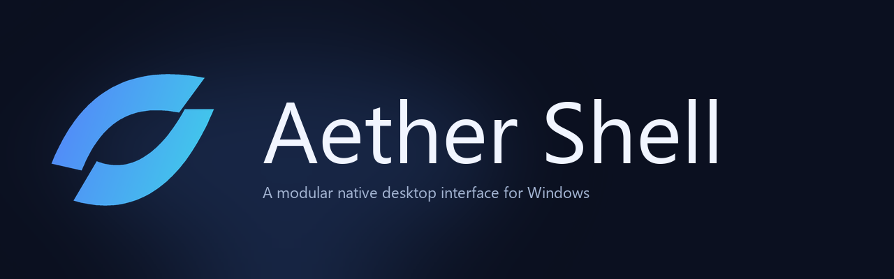

<p align="center">
  🇬🇧 <a href="README.md">English</a> · 🇫🇷 <a href="README.fr.md">Français</a> · 🇪🇸 <a href="README.es.md">Español</a>
  · 🇨🇳 <a href="README.zh-CN.md">中文</a> · 🇮🇳 <strong>हिन्दी</strong>
  · 🇧🇷 <a href="README.pt.md">Português</a> · 🇷🇺 <a href="README.ru.md">Русский</a> · 🇸🇦 <a href="README.ar.md">العربية</a>
  · 🇧🇩 <a href="README.bn.md">বাংলা</a> · 🇵🇰 <a href="README.ur.md">اردو</a>
</p>

<p align="center">
  <a href="https://github.com/ibrahimbouillet/AetherShell/releases/latest"><strong>नवीनतम रिलीज़ डाउनलोड करें</strong></a>
  · <a href="docs/i18n/hi/USER_GUIDE.md">उपयोग गाइड</a>
  · <a href="KNOWN_LIMITATIONS.md">ज्ञात सीमाएँ (अंग्रेज़ी में)</a>
  · <a href="docs/knowledge/TEST_STATUS.md">परीक्षण रिकॉर्ड (अंग्रेज़ी में)</a>
</p>

<p align="center">
  <a href="https://github.com/ibrahimbouillet/AetherShell/actions/workflows/ci.yml"></a>
  <a href="LICENSE"></a>
  
  <a href="https://www.youtube.com/@IbrahimBouillet"></a>
</p>


# Aether Shell

**Ibrahim Bouillet** द्वारा बनाया गया एक मूल Windows डेस्कटॉप इंटरफ़ेस। Aether Shell एक तैरते डॉक को एक छोटे
शीर्ष स्टेटस बार के साथ जोड़ता है, जिसमें हल्की धुंधली, पारभासी सामग्री का उपयोग होता है। इसे C++20, Win32,
Direct2D/DirectWrite और Windows.UI.Composition से बनाया गया है और यह MIT लाइसेंस के तहत जारी किया गया है।

> **अल्फ़ा सॉफ़्टवेयर:** 0.3.5-alpha.3 (Alpha 3, संस्करण 3.5) एक शुरुआती सार्वजनिक पूर्वावलोकन है। यह अभी
> Windows इंटरफ़ेस का पूरी तरह से परखा हुआ विकल्प नहीं है। आज़माने से पहले अपना काम सहेजें और
> [ज्ञात सीमाएँ](KNOWN_LIMITATIONS.md) पढ़ें।

> **जल्द आ रहा है: Alpha 4।** अगला संस्करण तैयार हो रहा है: चुनने के लिए दो शैलियाँ, *लिक्विड* (साफ़ पानी जैसा
> ग्लास) और *ग्रेन* (मौजूदा फ्रॉस्टेड सामग्री), Windows सेटिंग्स के पेज, फ़ाइलें और फ़ोल्डर भी खोजने वाली खोज,
> कई भाषाओं में इंटरफ़ेस, और ज़्यादा हल्का, ज़्यादा सहज अनुभव। यह कब आएगा, जानने के लिए
> [रिलीज़ पर नज़र रखें](https://github.com/ibrahimbouillet/AetherShell/releases)।

<h2 align="center">एक नया डेस्कटॉप। एक नया माहौल।</h2>

<p align="center">
  
</p>

<table>
  <tr>
    <td align="center" width="20%"><a href="./resources/preview/setup_preview-1.png"></a></td>
    <td align="center" width="20%"><a href="./resources/preview/setup_preview-5.webp"></a></td>
    <td align="center" width="20%"><a href="./resources/preview/setup_preview-4.webp"></a></td>
    <td align="center" width="20%"><a href="./resources/preview/setup_preview-3.webp"></a></td>
    <td align="center" width="20%"><a href="./resources/preview/setup_preview-2.png"></a></td>
  </tr>
</table>

<p align="center"><sub>एक डॉक और एक शीर्ष बार, जो आपके चुने हुए वॉलपेपर के रंग अपना लेते हैं। पूरे आकार में देखने के लिए कोई तस्वीर चुनें।<br>
Windows 11 पर लिए गए असली डेस्कटॉप। वॉलपेपर और ऐप्लिकेशन आइकन उनके मालिकों के हैं और इस प्रोजेक्ट के लाइसेंस में शामिल नहीं हैं।</sub></p>

## यह क्या करता है

- **डॉक:** ऐप्लिकेशन खोलें और उनके बीच स्विच करें, पसंदीदा रखें, पिन किए गए आइकनों का क्रम बदलें, चल रहे ऐप्स
  को एनिमेटेड चिह्नों के साथ और होवर करने पर उनकी विंडो के असली पूर्वावलोकन के साथ देखें, खोज खोलें, और स्टार्ट
  तथा टास्क व्यू तक पहुँचें।
- **शीर्ष स्टेटस बार:** Windows द्वारा दी गई घड़ी, इनपुट भाषा, नेटवर्क, ऑडियो और बैटरी की स्थिति दिखाता है। तारीख
  और समय Windows की सूचनाएँ और कैलेंडर खोलते हैं, एक शेवरॉन सूचना क्षेत्र के छिपे हुए आइकन खोलता है, और स्टेटस
  समूह Aether का क्विक सेटिंग्स पैनल उसकी Wi-Fi सूची के साथ खोलता है।
- **खोज:** ऐप्लिकेशन और Windows के अपने टूल ढूँढें और खोलें, जैसे डिवाइस मैनेजर, सेवाएँ या कंट्रोल पैनल के आइटम।
- **अपने-आप छिपना:** डॉक और शीर्ष बार, दोनों अलग-अलग, किसी ऐप्लिकेशन विंडो के ढकने पर हट जाते हैं और पॉइंटर के
  स्क्रीन के किनारे पर पहुँचने पर लौट आते हैं, ताकि पूरी स्क्रीन पर काम हो सके।
- **दस भाषाएँ:** पूरा इंटरफ़ेस, सेटअप सहित, अंग्रेज़ी, चीनी, हिंदी, स्पैनिश, फ़्रेंच, पुर्तगाली, रूसी, अरबी, बांग्ला और
  उर्दू में। यह आपकी Windows डिस्प्ले भाषाओं के अनुसार चलता है, या आप सेटिंग्स → भाषा में अपनी भाषा चुन सकते हैं, और यह
  चुनाव एक संस्करण से दूसरे संस्करण तक याद रखा जाता है। देखें [भाषाएँ](#भाषाएँ)।
- **स्वागत:** एक वैकल्पिक अभिवादन, जो साइन इन करने या PC अनलॉक करने के बाद आपके धुंधले वॉलपेपर पर फ़्रेंच,
  अंग्रेज़ी या स्पैनिश में हाथ से लिखा जाता है। सेटअप वह नाम पूछ सकता है जिससे यह आपका अभिवादन करे।
- **मौसम:** वैकल्पिक रूप से Windows स्थान अनुमति से अनुमानित स्थान और पूर्वानुमान। अगर स्थान या नेटवर्क उपलब्ध
  न हो, तो मौसम अनुमान लगाने के बजाय उपलब्ध नहीं दिखता।
- **गति और रूप:** बार, सेटिंग्स, मेनू और सेटअप में एक जैसा तटस्थ फ्रॉस्टेड ग्लास डिज़ाइन; सेटिंग्स में सहज
  स्क्रॉलिंग; जब Aether टास्कबार की जगह लेता है तो बड़ी की गई विंडो के गोल कोने; हल्का/गहरा रूप, कीबोर्ड नेविगेशन
  और कम गति का समर्थन।
- **रिकवरी:** प्रति-उपयोगकर्ता इंस्टॉलर, एक अलग रिकवरी सहायक, सुधार/अनइंस्टॉल समर्थन और Windows टास्कबार बहाल
  करने का कमांड।

## 3.5 में नया क्या है

संस्करण 3.5 ऐप्लिकेशनों के टैब और बंद करने के बटनों को नहीं छेड़ता (शीर्ष बार केवल स्क्रीन के सबसे ऊपरी किनारे
पर प्रतिक्रिया देता है), किसी और चीज़ का उपयोग करते ही पैनल बंद कर देता है, और खोज में Windows के अपने टूल ढूँढता
है। स्वागत अब पहली बार से ही आपका नाम लेता है, क्योंकि सेटअप इसे पूछता है; तस्वीर की फ़ाइल हटा या खिसका दिए जाने पर
भी यह आपका वॉलपेपर दिखाता है, और इसकी कलम हर फ़्रेम में कम काम के साथ चलती है।
[रिलीज़ नोट्स](docs/releases/0.3.5-alpha.3.md) और [बदलावों की सूची](CHANGELOG.md) (अंग्रेज़ी में) पढ़ें।

## भाषाएँ

Aether Shell दुनिया में सबसे ज़्यादा बोली जाने वाली दस भाषाएँ बोलता है। हर मेनू, पैनल, सेटिंग्स पेज, संदेश और
सेटअप स्क्रीन का अनुवाद किया गया है, और इस दस्तावेज़ का भी।

| | भाषा | इंटरफ़ेस | दस्तावेज़ |
|---|---|---|---|
| 🇬🇧 | English | ✅ | [README](README.md) · [User guide](USER_GUIDE.md) · [Installation](INSTALLATION.md) |
| 🇨🇳 | 中文（简体） | ✅ | [README](README.zh-CN.md) · [使用指南](docs/i18n/zh-CN/USER_GUIDE.md) · [安装](docs/i18n/zh-CN/INSTALLATION.md) |
| 🇮🇳 | हिन्दी | ✅ | [README](README.hi.md) · [उपयोग गाइड](docs/i18n/hi/USER_GUIDE.md) · [इंस्टॉलेशन](docs/i18n/hi/INSTALLATION.md) |
| 🇪🇸 | Español | ✅ | [README](README.es.md) · [Guía de uso](docs/i18n/es/USER_GUIDE.md) · [Instalación](docs/i18n/es/INSTALLATION.md) |
| 🇫🇷 | Français | ✅ | [README](README.fr.md) · [Guide d'utilisation](docs/i18n/fr/USER_GUIDE.md) · [Installation](docs/i18n/fr/INSTALLATION.md) |
| 🇧🇷 | Português | ✅ | [README](README.pt.md) · [Guia do usuário](docs/i18n/pt/USER_GUIDE.md) · [Instalação](docs/i18n/pt/INSTALLATION.md) |
| 🇷🇺 | Русский | ✅ | [README](README.ru.md) · [Руководство](docs/i18n/ru/USER_GUIDE.md) · [Установка](docs/i18n/ru/INSTALLATION.md) |
| 🇸🇦 | العربية | ✅ (दाएँ से बाएँ) | [README](README.ar.md) · [دليل الاستخدام](docs/i18n/ar/USER_GUIDE.md) · [التثبيت](docs/i18n/ar/INSTALLATION.md) |
| 🇧🇩 | বাংলা | ✅ | [README](README.bn.md) · [ব্যবহারকারী নির্দেশিকা](docs/i18n/bn/USER_GUIDE.md) · [ইনস্টলেশন](docs/i18n/bn/INSTALLATION.md) |
| 🇵🇰 | اردو | ✅ (दाएँ से बाएँ) | [README](README.ur.md) · [صارف گائیڈ](docs/i18n/ur/USER_GUIDE.md) · [انسٹالیشن](docs/i18n/ur/INSTALLATION.md) |

**Windows के अनुसार** (डिफ़ॉल्ट) आपकी Windows डिस्प्ले भाषाओं (सेटिंग्स → समय और भाषा) को आपके रखे क्रम में देखता है
और इन दस में से पहली भाषा लेता है; कोई न हो तो अंग्रेज़ी। कोई दूसरी भाषा **सेटिंग्स → भाषा** में चुनें; बदलाव तुरंत लागू
होता है और आपकी सेटिंग्स में रहता है, जिन्हें हर संस्करण पढ़ता है: नया संस्करण इंस्टॉल करने, मरम्मत करने या दोबारा
इंस्टॉल करने पर भी यह बना रहता है, और सेटअप, अपडेटर और लॉन्चर भी यही भाषा बोलते हैं। आपके या दूसरे प्रोग्रामों के नाम
(ऐप्लिकेशन, फ़ाइलें, Wi-Fi नेटवर्क) कभी अनुवादित नहीं होते। हाथ से लिखा स्वागत लैटिन अक्षर लिखता है, इसलिए यह फ़्रेंच,
अंग्रेज़ी या स्पैनिश में अभिवादन करता है। अरबी और उर्दू दाएँ से बाएँ पढ़ी जाती हैं: टेक्स्ट उसी हिसाब से बनता और
संरेखित होता है, जबकि बार और पैनल अपना लेआउट बनाए रखते हैं। अनुवाद [tools/i18n/catalog](tools/i18n/catalog) में हैं;
सुधारों का स्वागत है।

## Windows टास्कबार की जगह लेना

V2 अनुभव Aether Shell शुरू होने पर Windows टास्कबार छिपा देता है और उसकी जगह Aether डॉक दिखाता है। यह व्यवहार
डिफ़ॉल्ट रूप से चालू है और **Aether Shell सेटिंग्स → डेस्कटॉप** में बंद किया जा सकता है। Explorer चलता रहता है;
Aether Shell `explorer.exe` की जगह नहीं लेता, Winlogon शेल नहीं बदलता, और Windows सेटिंग्स में खुद को मूल टास्कबार
के रूप में पंजीकृत नहीं करता। Aether Shell बंद होने पर रिकवरी सहायक Windows टास्कबार बहाल करता है। अल्फ़ा आज़माने
से पहले [रिकवरी गाइड](docs/i18n/hi/USER_GUIDE.md) पढ़ें।

## डाउनलोड और इंस्टॉल

[GitHub पर नवीनतम रिलीज़](https://github.com/ibrahimbouillet/AetherShell/releases/latest) से **x64 सेटअप फ़ाइल**
डाउनलोड करें और उसके SHA-256 की तुलना रिलीज़ की चेकसम फ़ाइल से करें। सेटअप अपने सामान्य Windows उपयोगकर्ता के रूप
में चलाएँ। इंस्टॉलर टास्कबार का व्यवहार समझाता है और व्यवस्थापक अधिकार नहीं माँगता। नया सेटअप **साइन इन पर
शुरू करें** को साफ़ तौर पर चुना हुआ दिखाता है; स्वीकार करने से पहले आप इसे हटा सकते हैं। पहले से सहेजे गए विकल्प
और टास्क मैनेजर में किए गए बंद का सम्मान होता है। सेटअप उस नाम के लिए एक वैकल्पिक फ़ील्ड भी देता है जिससे स्वागत
आपका अभिवादन करे; यह आपके PC पर ही रहता है। इंस्टॉल किया गया लॉन्चर सीमित संख्या में असामान्य क्रैश के बाद ऐप
फिर शुरू कर सकता है; बंद करना, रिकवरी और अनइंस्टॉल उपलब्ध रहते हैं। स्टार्टअप का समय Windows तय करता है, इसलिए
Aether यह गारंटी नहीं दे सकता कि साइन इन पर उसका इंटरफ़ेस मूल टास्कबार से पहले दिखेगा।

यह अल्फ़ा हाथ से इंस्टॉल किया जाता है। स्वचालित अपडेट के लिए हस्ताक्षरित रिलीज़ मैनिफ़ेस्ट ज़रूरी है; कोई
बिना हस्ताक्षर वाला मैनिफ़ेस्ट प्रकाशित नहीं किया जाता। सेटअप फ़ाइल Authenticode से हस्ताक्षरित नहीं है, इसलिए
Windows SmartScreen चेतावनी दिखा सकता है। देखें [इंस्टॉलेशन और सत्यापन](docs/i18n/hi/INSTALLATION.md)।

## संगतता

- Windows 11, x64: वर्तमान विकास लक्ष्य।
- Windows 10 2004+ x64: डिज़ाइन में समर्थित, लेकिन इस रिलीज़ में अभी चलाकर परखा नहीं गया।
- ARM64: अभी चलाकर परखा नहीं गया।

Windows 10 पर पृष्ठभूमि का धुंधलापन एक सरल रंगत का उपयोग करता है। डॉक मूल टास्कबार की हर सुविधा नहीं दोहराता, और
Windows सेटिंग्स Windows टास्कबार को सँभालती रहती हैं। सभी [ज्ञात सीमाएँ](KNOWN_LIMITATIONS.md) देखें।

## बिल्ड और परीक्षण

Windows पर Visual Studio C++ बिल्ड टूल्स, एक Windows SDK, CMake, Ninja और Python से बिल्ड करें:

```powershell
./scripts/build.ps1 -Config release -BuildDir build/release -Test -TestExclude 'network|integration' `
    -CMakeArgs '-DAETHER_WARNINGS_AS_ERRORS=ON'
```

प्रति-उपयोगकर्ता इंस्टॉलर बनाने और उसके पैकेज की गोपनीयता/ताज़गी जाँच चलाने के लिए:

```powershell
./scripts/package.ps1 -BuildDir build/release
```

मॉड्यूल-स्तर के परीक्षणों के लिए [BUILDING.md](BUILDING.md), परीक्षण अलगाव और मैन्युअल जाँच के लिए
[TESTING.md](TESTING.md), और सटीक परिणामों के लिए [चलाए गए परीक्षणों का रिकॉर्ड](docs/knowledge/TEST_STATUS.md)
देखें (दस्तावेज़ अंग्रेज़ी में)। सफल बिल्ड या परीक्षण अपने-आप में हर Windows संस्करण या डिवाइस को प्रमाणित नहीं करते।

## प्रोजेक्ट दस्तावेज़

- [उपयोग गाइड](docs/i18n/hi/USER_GUIDE.md) · [इंस्टॉलेशन](docs/i18n/hi/INSTALLATION.md)
- अंग्रेज़ी में: [आर्किटेक्चर](ARCHITECTURE.md) · [प्रोजेक्ट विनिर्देश](PROJECT_SPEC.md) · [कार्य स्थिति](TASKS.md)
  · [अपडेट और रोलबैक](UPDATE_AND_ROLLBACK.md) · [सुरक्षा नीति](SECURITY.md) · [योगदान](CONTRIBUTING.md)
  · [तृतीय-पक्ष सूचनाएँ](THIRD_PARTY_NOTICES.md)

योगदानकर्ता और कोडिंग सहायक [AGENTS.md](AGENTS.md) और [HANDOFF.md](HANDOFF.md) से शुरू करें।

## लाइसेंस

MIT। देखें [LICENSE](LICENSE)।
