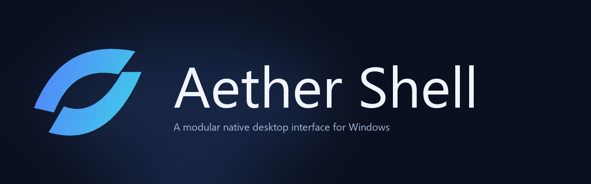
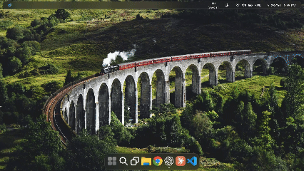
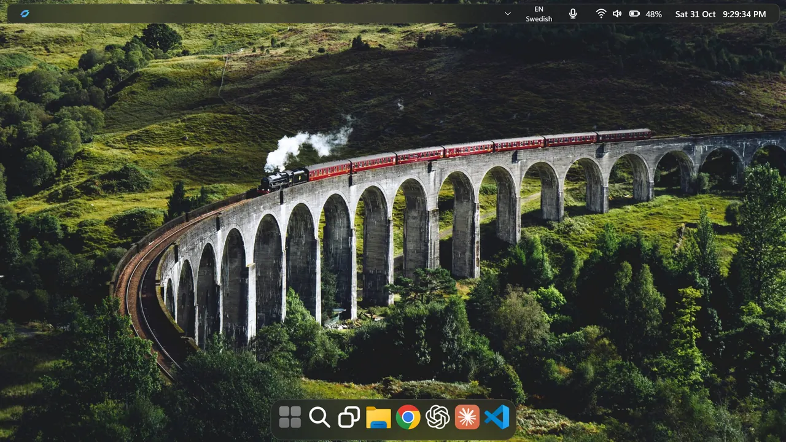
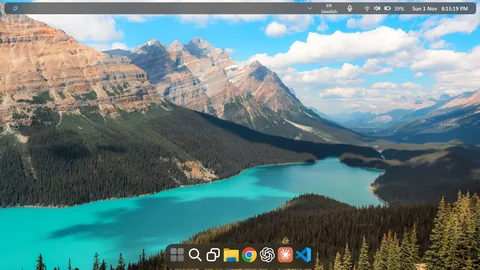
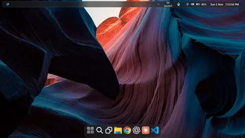
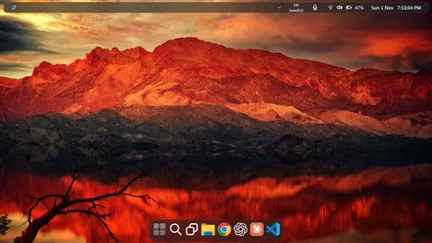
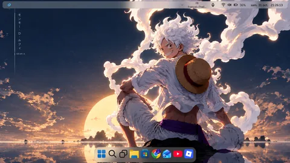

<p align="center">
  <a href="https://github.com/ibrahimbouillet/AetherShell/releases/latest"><strong>Download the latest release</strong></a>
  · <a href="USER_GUIDE.md">User guide</a>
  · <a href="KNOWN_LIMITATIONS.md">Known limitations</a>
  · <a href="docs/knowledge/TEST_STATUS.md">Test evidence</a>
</p>

<p align="center">
  <a href="https://github.com/ibrahimbouillet/AetherShell/actions/workflows/ci.yml"></a>
  <a href="LICENSE"></a>
  
  <a href="https://www.youtube.com/@IbrahimBouillet"></a>
</p>



# Aether Shell

A native Windows desktop interface by **Ibrahim Bouillet**. Aether Shell pairs a floating Dock with
a compact Top Status Bar, using a softly blurred, translucent material. It is built in C++20 with
Win32, Direct2D/DirectWrite and Windows.UI.Composition, and is released under the MIT License.

> **Alpha software:** 0.3.5-alpha.3 (Alpha 3, version 3.5) is an early public preview. It is not a fully qualified
> Windows shell replacement. Save your work before testing and read the [known limitations](KNOWN_LIMITATIONS.md).

<h2 align="center">A New Desktop. A New Atmosphere.</h2>

<p align="center">
  
</p>

<table>
  <tr>
    <td align="center" width="20%"><a href="./resources/preview/setup_preview-1.png"></a></td>
    <td align="center" width="20%"><a href="./resources/preview/setup_preview-5.webp"></a></td>
    <td align="center" width="20%"><a href="./resources/preview/setup_preview-4.webp"></a></td>
    <td align="center" width="20%"><a href="./resources/preview/setup_preview-3.webp"></a></td>
    <td align="center" width="20%"><a href="./resources/preview/setup_preview-2.png"></a></td>
  </tr>
</table>

<p align="center"><sub>One Dock and one Top Bar that take on the colours of whatever wallpaper you choose. Select a picture to see it at full size.<br>
Real desktops, captured on Windows 11. Wallpapers and application icons belong to their owners and are not covered by this project's license.</sub></p>

## What it does

- **Dock:** launch and switch between applications, keep favorites, reorder pinned icons, see running
  apps with animated markers and genuine window previews on hover, open Search, and reach Start and
  Task View.
- **Top Status Bar:** show Windows-provided clock, input language, network, audio and battery status.
  The date and time open Windows notifications and the calendar, a chevron opens Windows' hidden
  notification-area icons, and the grouped status action opens Aether's Quick Settings panel, with its
  Wi-Fi list.
- **Search:** find and open applications and Windows' own tools, such as Device Manager, Services or the
  Control Panel's items.
- **Auto-Hide:** let the Dock and the Top Bar, each on its own, slide away while an application window
  covers them and return when the pointer reaches their screen edge, for a full-screen workspace.
- **Welcome:** an optional greeting, written by hand in French or English over your blurred wallpaper,
  after you sign in or unlock your PC. Setup can ask for the name it greets you with.
- **Weather:** optionally use Windows location permission for a coarse position and a forecast. If
  location or the network is unavailable, weather remains unavailable rather than guessing.
- **Motion and appearance:** one neutral frosted-glass design across the bars, Settings, menus and
  setup; fluid Settings scrolling; rounded maximized windows while Aether replaces the taskbar;
  dark/light appearance, keyboard navigation and reduced-motion support.
- **Recovery:** a per-user installer, a separate recovery helper, repair/uninstall support and a
  Windows-taskbar restore command.

## What's new in 3.5

Version 3.5 leaves applications' tabs and close buttons alone (the Top Bar answers only to the very top of the screen), closes
panels as soon as you use anything else, and finds Windows' own tools in Search. The welcome now greets you by name from the first
time, because setup asks for it; it shows your wallpaper even when the picture's file was moved or deleted, and its pen flows with
less work per frame. Read the [release notes](docs/releases/0.3.5-alpha.3.md) and the [changelog](CHANGELOG.md).

## Replacing the Windows taskbar

The V2 experience hides the Windows taskbar when Aether Shell starts, then displays the Aether Dock
in its place. This behavior is enabled by default and can be switched off in **Aether Shell Settings
→ Desktop**. Explorer continues running; Aether Shell does not replace `explorer.exe`, change the
Winlogon shell, or register itself as the native taskbar in Windows Settings. The recovery helper
restores the Windows taskbar when Aether Shell exits. Read the [recovery guide](USER_GUIDE.md) before
trying the alpha.

## Download and install

Download the **x64 setup executable** from the [latest GitHub Release](https://github.com/ibrahimbouillet/AetherShell/releases/latest)
and compare its SHA-256 with the release's checksums file. Run setup as your regular Windows user.
The installer explains the taskbar behavior and does not require administrator rights. Fresh setup
visibly selects **start at sign-in**; you can clear that option before accepting. Existing saved
choices and Task Manager startup disables are respected. Setup also offers an optional field for the
name the welcome greets you with; it stays on your PC. The installed launcher can retry a limited
number of abnormal crashes; Quit, recovery and uninstall remain available. Windows controls startup
timing, so Aether cannot guarantee that its interface appears before the native taskbar at sign-in.

This alpha is distributed for manual installation. Automatic updates require a signed release
manifest; no unsigned manifest is published. The setup binary is not Authenticode-signed, so Windows
may show a SmartScreen warning. See [installation and verification](INSTALLATION.md).

## Compatibility

- Windows 11, x64: current development target.
- Windows 10 2004+ x64: supported by the design, but not runtime-qualified in this release.
- ARM64: not runtime-qualified.

Windows 10 backdrop blur uses a simpler tint. The Dock does not reproduce every native taskbar
feature, and Windows Settings continues to manage the Windows taskbar. See the full [known
limitations](KNOWN_LIMITATIONS.md).

## Build and test

Build on Windows with Visual Studio C++ Build Tools, a Windows SDK, CMake, Ninja and Python:

```powershell
./scripts/build.ps1 -Config release -BuildDir build/release -Test -TestExclude 'network|integration' `
    -CMakeArgs '-DAETHER_WARNINGS_AS_ERRORS=ON'
```

To build the per-user installer and run its package privacy/freshness audit:

```powershell
./scripts/package.ps1 -BuildDir build/release
```

See [BUILDING.md](BUILDING.md) for focused module tests, [TESTING.md](TESTING.md) for test isolation
and manual qualification, and [the executed test record](docs/knowledge/TEST_STATUS.md) for exact
results. A successful build or test suite does not by itself qualify every Windows version or device.

## Project documents

- [Architecture](ARCHITECTURE.md) · [Project specification](PROJECT_SPEC.md) · [Task status](TASKS.md)
- [User guide](USER_GUIDE.md) · [Installation](INSTALLATION.md) · [Update and rollback](UPDATE_AND_ROLLBACK.md)
- [Security policy](SECURITY.md) · [Contributing](CONTRIBUTING.md) · [Third-party notices](THIRD_PARTY_NOTICES.md)

For contributors and coding assistants, start with [AGENTS.md](AGENTS.md) and [HANDOFF.md](HANDOFF.md).

## License

MIT. See [LICENSE](LICENSE).
