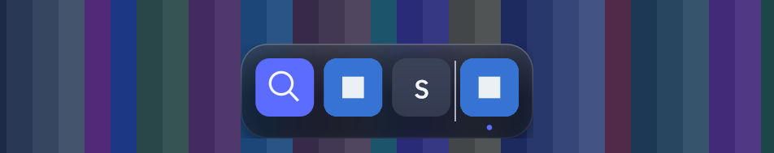
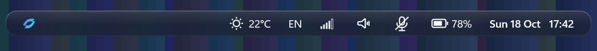
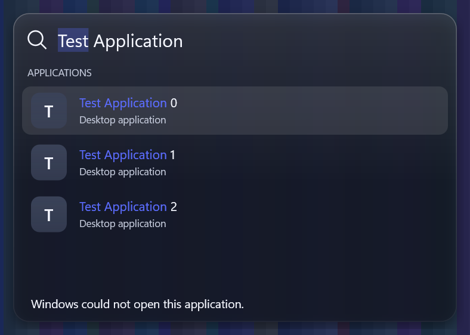

A native Windows desktop interface by **Ibrahim Bouillet**: a floating application Dock and a
separate Top Status Bar, running alongside Windows Explorer. Built with C++20, Win32,
Direct2D/DirectWrite and Windows.UI.Composition. MIT licensed.

**Development alpha — 0.1.0-alpha.1.** The first complete application and installer are undergoing
qualification. See [known limitations](KNOWN_LIMITATIONS.md) and [executed test evidence](docs/knowledge/TEST_STATUS.md)
before relying on a feature. A release is available only when an asset appears on the
[official Releases page](https://github.com/ibrahimbouillet/AetherShell/releases).

- Dock: pinned and running applications, icons, search, keyboard navigation and motion preferences.
- Top Bar: real clock/date, battery when present, input language, network, audio and microphone state.
- Search: application catalogue matching, accent-insensitive ranking and keyboard selection.
- Settings: Dock, Top Bar, opt-in weather, updates, shortcuts, startup consent and diagnostics.
- Delivery: per-user setup, versioned installation, repair, uninstall and authenticated update design.

Windows 10 2004+ and Windows 11, x64. Windows 10 and ARM64 remain unqualified. Explorer and the
Windows taskbar stay available. Weather is disabled by default; enabling it sends the selected
coordinates to Open-Meteo. No location detection or Wi-Fi network names are used.

Read the [user guide](USER_GUIDE.md), [installation guide](INSTALLATION.md), and
[update and rollback guide](UPDATE_AND_ROLLBACK.md).

These dark-theme previews come from isolated rendering tests. Application names, status values and
the search error are synthetic fixtures; the images contain only the project's own test windows.





Light-theme fixtures: [Dock](resources/screenshots/dock-light-hover.png),
[Top Bar](resources/screenshots/topbar-light.png), [Search](resources/screenshots/search-light.png).

Build on Windows with Visual Studio C++ Build Tools, a Windows SDK, CMake and Ninja:

```powershell
./scripts/build.ps1 -Config release -BuildDir build/release -Test -TestExclude 'network|integration'
./scripts/package.ps1 -BuildDir build/release -SkipBuild
```

See [BUILDING](BUILDING.md) for focused modules and interactive tests. Python is needed for release
packaging/branding tools, not to run the app. No third-party C++ runtime library is bundled.

For contributors and coding assistants: start with [AGENTS](AGENTS.md), [HANDOFF](HANDOFF.md),
[PROJECT_SPEC](PROJECT_SPEC.md) and [TASKS](TASKS.md). The Markdown/source files are portable;
Obsidian and Graphify are optional local development tools. Never commit personal information,
credentials, build output or local tool state. Read [CONTRIBUTING](CONTRIBUTING.md),
[SECURITY](SECURITY.md) and [third-party notices](THIRD_PARTY_NOTICES.md).
