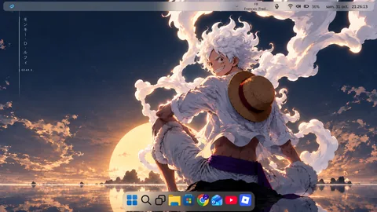

<p align="center">
  🇬🇧 <a href="README.md">English</a> · 🇫🇷 <a href="README.fr.md">Français</a> · 🇪🇸 <a href="README.es.md">Español</a>
  · 🇨🇳 <a href="README.zh-CN.md">中文</a> · 🇮🇳 <a href="README.hi.md">हिन्दी</a>
  · 🇧🇷 <strong>Português</strong> · 🇷🇺 <a href="README.ru.md">Русский</a> · 🇸🇦 <a href="README.ar.md">العربية</a>
  · 🇧🇩 <a href="README.bn.md">বাংলা</a> · 🇵🇰 <a href="README.ur.md">اردو</a>
</p>

<p align="center">
  <a href="https://github.com/ibrahimbouillet/AetherShell/releases/latest"><strong>Baixar a versão mais recente</strong></a>
  · <a href="docs/i18n/pt/USER_GUIDE.md">Guia do usuário</a>
  · <a href="KNOWN_LIMITATIONS.md">Limitações conhecidas (em inglês)</a>
  · <a href="docs/knowledge/TEST_STATUS.md">Resultados dos testes (em inglês)</a>
</p>

<p align="center">
  <a href="https://github.com/ibrahimbouillet/AetherShell/actions/workflows/ci.yml"></a>
  <a href="LICENSE"></a>
  
  <a href="https://www.youtube.com/@IbrahimBouillet"></a>
</p>


# Aether Shell

Uma interface de área de trabalho nativa para Windows criada por **Ibrahim Bouillet**. O Aether Shell reúne um Dock
flutuante e uma Barra de Status superior compacta, com um material translúcido e suavemente desfocado. Ele é escrito em
C++20 com Win32, Direct2D/DirectWrite e Windows.UI.Composition, e é distribuído sob a Licença MIT.

> **Software em fase alfa:** a versão 0.3.5-alpha.3 (Alpha 3, versão 3.5) é uma prévia pública inicial. Ela não é um
> substituto do shell do Windows totalmente qualificado. Salve seu trabalho antes de testar e leia as
> [limitações conhecidas](KNOWN_LIMITATIONS.md) (em inglês).

> **Em breve: Alpha 4.** A próxima versão está em desenvolvimento: dois estilos à escolha, *Liquid* (vidro de água
> transparente) e *Grain* (o material fosco de hoje), uma Pesquisa que também encontra as páginas de Configurações do
> Windows, arquivos e pastas, uma interface em vários idiomas que segue o idioma de exibição do seu Windows e um shell
> mais leve e mais fluido. [Acompanhe as versões](https://github.com/ibrahimbouillet/AetherShell/releases)
> para saber quando ela sair.

<h2 align="center">Uma nova área de trabalho. Uma nova atmosfera.</h2>

<p align="center">
  
</p>

<table>
  <tr>
    <td align="center" width="20%"><a href="./resources/preview/setup_preview-1.png"></a></td>
    <td align="center" width="20%"><a href="./resources/preview/setup_preview-5.webp"></a></td>
    <td align="center" width="20%"><a href="./resources/preview/setup_preview-4.webp"></a></td>
    <td align="center" width="20%"><a href="./resources/preview/setup_preview-3.webp"></a></td>
    <td align="center" width="20%"><a href="./resources/preview/setup_preview-2.png"></a></td>
  </tr>
</table>

<p align="center"><sub>Um Dock e uma Barra superior que assumem as cores de qualquer papel de parede que você escolher. Selecione uma imagem para vê-la em tamanho real.<br>
Áreas de trabalho reais, capturadas no Windows 11. Os papéis de parede e os ícones de aplicativos pertencem aos seus proprietários e não são cobertos pela licença deste projeto.</sub></p>

## O que ele faz

- **Dock:** abrir e alternar entre aplicativos, manter favoritos, reordenar os ícones fixados, ver os aplicativos em
  execução com marcadores animados e pré-visualizações reais das janelas ao passar o mouse, abrir a Pesquisa e acessar o
  Iniciar e a Visão de Tarefas.
- **Barra de Status superior:** mostra o relógio, o idioma de entrada, a rede, o áudio e a bateria fornecidos pelo
  Windows. A data e a hora abrem as notificações e o calendário do Windows, uma seta abre os ícones ocultos da área de
  notificação do Windows, e a ação de status agrupada abre o painel de Configurações rápidas do Aether, com sua lista de
  redes Wi-Fi.
- **Pesquisa:** encontre e abra aplicativos e as próprias ferramentas do Windows, como o Gerenciador de Dispositivos, os
  Serviços ou os itens do Painel de Controle.
- **Ocultação automática:** deixe o Dock e a Barra superior, cada um por conta própria, deslizarem para fora enquanto uma
  janela de aplicativo os cobre e voltarem quando o ponteiro chega à borda da tela, para um espaço de trabalho em tela
  cheia.
- **Dez idiomas:** toda a interface, instalação incluída, em inglês, chinês, hindi, espanhol, francês, português, russo,
  árabe, bengali e urdu. Ela segue os idiomas de exibição do seu Windows, ou aquele que você escolher em Configurações →
  Idioma, e lembra dessa escolha de uma versão para outra. Veja [Idiomas](#idiomas).
- **Boas-vindas:** uma saudação opcional, escrita à mão em francês, inglês ou espanhol sobre o seu papel de parede
  desfocado, depois que você entra ou desbloqueia o PC. A instalação pode perguntar o nome com que ela o cumprimenta.
- **Clima:** use opcionalmente a permissão de localização do Windows para uma posição aproximada e uma previsão. Se a
  localização ou a rede estiver indisponível, o clima permanece indisponível em vez de adivinhar.
- **Movimento e aparência:** um único design neutro de vidro fosco nas barras, nas Configurações, nos menus e na
  instalação; rolagem fluida nas Configurações; janelas maximizadas com cantos arredondados enquanto o Aether substitui
  a barra de tarefas; aparência clara/escura, navegação pelo teclado e suporte a movimento reduzido.
- **Recuperação:** um instalador por usuário, um auxiliar de recuperação separado, suporte a reparo/desinstalação e um
  comando para restaurar a barra de tarefas do Windows.

## Novidades da 3.5

A versão 3.5 deixa em paz as guias e os botões de fechar dos aplicativos (a Barra superior só responde ao topo extremo da
tela), fecha os painéis assim que você usa qualquer outra coisa e encontra as próprias ferramentas do Windows na Pesquisa.
As boas-vindas agora o cumprimentam pelo nome desde a primeira vez, porque a instalação o pergunta; elas mostram o seu
papel de parede mesmo quando o arquivo da imagem foi movido ou apagado, e a caneta flui com menos trabalho por quadro.
Leia as [notas da versão](docs/releases/0.3.5-alpha.3.md) e o [registro de alterações](CHANGELOG.md) (em inglês).

## Idiomas

O Aether Shell fala os dez idiomas mais falados do mundo. Todo menu, painel, página de Configurações, mensagem e tela de
instalação está traduzido, e esta documentação também.

| | Idioma | Interface | Documentação |
|---|---|---|---|
| 🇬🇧 | English | ✅ | [README](README.md) · [User guide](USER_GUIDE.md) · [Installation](INSTALLATION.md) |
| 🇨🇳 | 中文（简体） | ✅ | [README](README.zh-CN.md) · [使用指南](docs/i18n/zh-CN/USER_GUIDE.md) · [安装](docs/i18n/zh-CN/INSTALLATION.md) |
| 🇮🇳 | हिन्दी | ✅ | [README](README.hi.md) · [उपयोग गाइड](docs/i18n/hi/USER_GUIDE.md) · [इंस्टॉलेशन](docs/i18n/hi/INSTALLATION.md) |
| 🇪🇸 | Español | ✅ | [README](README.es.md) · [Guía de uso](docs/i18n/es/USER_GUIDE.md) · [Instalación](docs/i18n/es/INSTALLATION.md) |
| 🇫🇷 | Français | ✅ | [README](README.fr.md) · [Guide d'utilisation](docs/i18n/fr/USER_GUIDE.md) · [Installation](docs/i18n/fr/INSTALLATION.md) |
| 🇧🇷 | Português | ✅ | [README](README.pt.md) · [Guia do usuário](docs/i18n/pt/USER_GUIDE.md) · [Instalação](docs/i18n/pt/INSTALLATION.md) |
| 🇷🇺 | Русский | ✅ | [README](README.ru.md) · [Руководство](docs/i18n/ru/USER_GUIDE.md) · [Установка](docs/i18n/ru/INSTALLATION.md) |
| 🇸🇦 | العربية | ✅ (da direita para a esquerda) | [README](README.ar.md) · [دليل الاستخدام](docs/i18n/ar/USER_GUIDE.md) · [التثبيت](docs/i18n/ar/INSTALLATION.md) |
| 🇧🇩 | বাংলা | ✅ | [README](README.bn.md) · [ব্যবহারকারী নির্দেশিকা](docs/i18n/bn/USER_GUIDE.md) · [ইনস্টলেশন](docs/i18n/bn/INSTALLATION.md) |
| 🇵🇰 | اردو | ✅ (da direita para a esquerda) | [README](README.ur.md) · [صارف گائیڈ](docs/i18n/ur/USER_GUIDE.md) · [انسٹالیشن](docs/i18n/ur/INSTALLATION.md) |

**Seguir o Windows** (o padrão) percorre os idiomas de exibição do seu Windows (Configurações → Hora e idioma), na ordem
em que você os classificou, e usa o primeiro que for um destes dez; se nenhum for, usa o inglês. Escolha outro em
**Configurações → Idioma**; a mudança vale na hora e fica guardada nas suas configurações, que todas as versões leem:
instalar uma nova versão, reparar ou reinstalar mantém a escolha, e a instalação, o atualizador e o inicializador também
a usam. Nomes que pertencem a você ou a outros programas (aplicativos, arquivos, redes Wi-Fi) nunca são traduzidos. As
boas-vindas manuscritas escrevem com letras latinas, por isso cumprimentam em francês, inglês ou espanhol. O árabe e o
urdu são lidos da direita para a esquerda: o texto é formado e alinhado de acordo, enquanto as barras e os painéis
mantêm o seu layout. As traduções ficam em [tools/i18n/catalog](tools/i18n/catalog); correções são bem-vindas.

## Substituir a barra de tarefas do Windows

A experiência V2 oculta a barra de tarefas do Windows quando o Aether Shell inicia e exibe o Dock do Aether no lugar
dela. Esse comportamento vem ativado por padrão e pode ser desligado em **Configurações do Aether Shell → Área de
trabalho**. O Explorer continua em execução; o Aether Shell não substitui o `explorer.exe`, não altera o shell do
Winlogon e não se registra como a barra de tarefas nativa nas Configurações do Windows. O auxiliar de recuperação
restaura a barra de tarefas do Windows quando o Aether Shell é encerrado. Leia o [guia de recuperação](docs/i18n/pt/USER_GUIDE.md)
antes de experimentar a versão alfa.

## Baixar e instalar

Baixe o **executável de instalação x64** da [última versão no GitHub](https://github.com/ibrahimbouillet/AetherShell/releases/latest)
e compare o SHA-256 dele com o arquivo de somas de verificação da versão. Execute a instalação como o seu usuário comum do
Windows. O instalador explica o comportamento da barra de tarefas e não exige direitos de administrador. Uma instalação
nova seleciona visivelmente **iniciar ao entrar**; você pode desmarcar essa opção antes de aceitar. As escolhas já salvas
e as desativações feitas no Gerenciador de Tarefas são respeitadas. A instalação também oferece um campo opcional para o
nome com que as boas-vindas o cumprimentam; ele fica no seu PC. O inicializador instalado pode tentar de novo um número
limitado de falhas anormais; Sair, a recuperação e a desinstalação continuam disponíveis. O Windows controla o momento da
inicialização, então o Aether não pode garantir que a sua interface apareça antes da barra de tarefas nativa ao entrar.

Esta versão alfa é distribuída para instalação manual. As atualizações automáticas exigem um manifesto de versão
assinado; nenhum manifesto não assinado é publicado. O binário de instalação não tem assinatura Authenticode, então o
Windows pode mostrar um aviso do SmartScreen. Veja [instalação e verificação](docs/i18n/pt/INSTALLATION.md).

## Compatibilidade

- Windows 11, x64: alvo atual de desenvolvimento.
- Windows 10 2004+ x64: compatível pelo projeto, mas sem qualificação em execução nesta versão.
- ARM64: sem qualificação em execução.

O desfoque de fundo do Windows 10 usa uma tonalidade mais simples. O Dock não reproduz todos os recursos da barra de
tarefas nativa, e as Configurações do Windows continuam gerenciando a barra de tarefas do Windows. Veja as
[limitações conhecidas](KNOWN_LIMITATIONS.md) completas (em inglês).

## Compilar e testar

Compile no Windows com as Ferramentas de Build do Visual Studio para C++, um SDK do Windows, CMake, Ninja e Python:

```powershell
./scripts/build.ps1 -Config release -BuildDir build/release -Test -TestExclude 'network|integration' `
    -CMakeArgs '-DAETHER_WARNINGS_AS_ERRORS=ON'
```

Para compilar o instalador por usuário e executar a auditoria de privacidade e atualidade do pacote:

```powershell
./scripts/package.ps1 -BuildDir build/release
```

Veja [BUILDING.md](BUILDING.md) para testes focados por módulo, [TESTING.md](TESTING.md) para o isolamento dos testes e
a qualificação manual, e [o registro dos testes executados](docs/knowledge/TEST_STATUS.md) para os resultados exatos
(todos em inglês). Uma compilação ou uma suíte de testes bem-sucedida não qualifica, por si só, todas as versões do
Windows nem todos os dispositivos.

## Documentos do projeto

- [Arquitetura](ARCHITECTURE.md) · [Especificação do projeto](PROJECT_SPEC.md) · [Estado das tarefas](TASKS.md)
- [Guia do usuário](docs/i18n/pt/USER_GUIDE.md) · [Instalação](docs/i18n/pt/INSTALLATION.md) · [Atualização e reversão](UPDATE_AND_ROLLBACK.md)
- [Política de segurança](SECURITY.md) · [Como contribuir](CONTRIBUTING.md) · [Avisos de terceiros](THIRD_PARTY_NOTICES.md)

Para colaboradores e assistentes de código, comece por [AGENTS.md](AGENTS.md) e [HANDOFF.md](HANDOFF.md).

## Licença

MIT. Veja [LICENSE](LICENSE).
