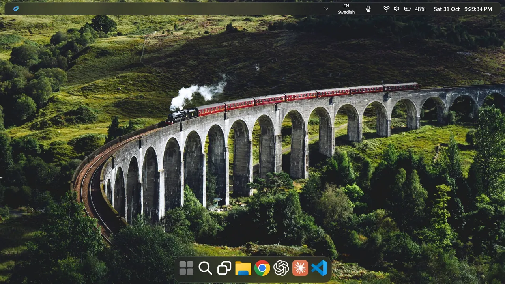

<p align="center">
  🇬🇧 <a href="README.md">English</a> · 🇫🇷 <a href="README.fr.md">Français</a> · 🇪🇸 <a href="README.es.md">Español</a>
  · 🇨🇳 <a href="README.zh-CN.md">中文</a> · 🇮🇳 <a href="README.hi.md">हिन्दी</a>
  · 🇧🇷 <a href="README.pt.md">Português</a> · 🇷🇺 <strong>Русский</strong> · 🇸🇦 <a href="README.ar.md">العربية</a>
  · 🇧🇩 <a href="README.bn.md">বাংলা</a> · 🇵🇰 <a href="README.ur.md">اردو</a>
</p>

<p align="center">
  <a href="https://github.com/ibrahimbouillet/AetherShell/releases/latest"><strong>Скачать последнюю версию</strong></a>
  · <a href="docs/i18n/ru/USER_GUIDE.md">Руководство пользователя</a>
  · <a href="KNOWN_LIMITATIONS.md">Известные ограничения (на английском)</a>
  · <a href="docs/knowledge/TEST_STATUS.md">Результаты тестов (на английском)</a>
</p>

<p align="center">
  <a href="https://github.com/ibrahimbouillet/AetherShell/actions/workflows/ci.yml"></a>
  <a href="LICENSE"></a>
  
  <a href="https://www.youtube.com/@IbrahimBouillet"></a>
</p>


# Aether Shell

Нативный интерфейс рабочего стола Windows, созданный **Ibrahim Bouillet**. Aether Shell сочетает плавающий Dock и
компактную верхнюю панель состояния с мягким размытым полупрозрачным материалом. Он написан на C++20 с использованием
Win32, Direct2D/DirectWrite и Windows.UI.Composition и распространяется по лицензии MIT.

> **Альфа-версия:** 0.4.0-alpha.4 (Alpha 4) — ранний публичный предварительный выпуск. Это не полностью
> проверенная замена оболочки Windows. Сохраняйте свою работу перед тестированием и прочитайте
> [известные ограничения](KNOWN_LIMITATIONS.md) (на английском).

<h2 align="center">Новый рабочий стол. Новая атмосфера.</h2>

<p align="center">
  
</p>

<table>
  <tr>
    <td align="center" width="20%"><a href="./resources/preview/setup_preview-1.png"></a></td>
    <td align="center" width="20%"><a href="./resources/preview/setup_preview-5.webp"></a></td>
    <td align="center" width="20%"><a href="./resources/preview/setup_preview-4.webp"></a></td>
    <td align="center" width="20%"><a href="./resources/preview/setup_preview-3.webp"></a></td>
    <td align="center" width="20%"><a href="./resources/preview/setup_preview-2.png"></a></td>
  </tr>
</table>

<p align="center"><sub>Один Dock и одна верхняя панель, которые принимают цвета любых выбранных вами обоев. Выберите картинку, чтобы увидеть её в полном размере.<br>
Настоящие рабочие столы, снятые в Windows 11. Обои и значки приложений принадлежат их владельцам и не покрываются лицензией этого проекта.</sub></p>

## Что он умеет

- **Dock:** запускать приложения и переключаться между ними, хранить избранное, менять порядок закреплённых значков,
  видеть запущенные приложения с анимированными маркерами и настоящими миниатюрами окон при наведении, открывать поиск и
  добираться до меню «Пуск» и представления задач.
- **Верхняя панель состояния:** показывает предоставляемые Windows часы, язык ввода, сеть, звук и батарею. Дата и время
  открывают уведомления и календарь Windows, стрелка открывает скрытые значки области уведомлений Windows, а
  сгруппированное действие состояния открывает панель быстрых параметров Aether со списком сетей Wi-Fi.
- **Поиск:** находит и открывает приложения и собственные средства Windows, такие как диспетчер устройств, службы или
  элементы панели управления.
- **Автоскрытие:** позволяет Dock и верхней панели, каждой по отдельности, уезжать за край, пока их закрывает окно
  приложения, и возвращаться, когда указатель достигает края экрана, — для рабочего пространства на весь экран.
- **41 язык:** весь интерфейс, включая программу установки, на 38 языках, которые предлагает Windows 11, а также на
  бенгальском, хинди и урду. Он следует языкам интерфейса вашей Windows или языку, выбранному в «Параметры → Язык», и
  запоминает этот выбор от версии к версии. Каждый язык скачивается из выпуска, когда он нужен. См. раздел
  [Языки](#языки).
- **Приветствие:** необязательное приветствие, написанное от руки по-французски, по-английски или по-испански на
  размытых обоях, после входа в систему или разблокировки ПК. Программа установки может спросить имя, по которому к вам
  будут обращаться.
- **Погода:** при желании использует разрешение Windows на определение расположения для приблизительной позиции и
  прогноза. Если расположение или сеть недоступны, погода остаётся недоступной, а не угадывается.
- **Анимация и внешний вид:** единый нейтральный дизайн из матового стекла в панелях, параметрах, меню и программе
  установки; плавная прокрутка параметров; скруглённые развёрнутые окна, пока Aether заменяет панель задач; светлая и
  тёмная темы, навигация с клавиатуры и поддержка уменьшенной анимации.
- **Восстановление:** установщик для одного пользователя, отдельная программа восстановления, поддержка ремонта и
  удаления и команда возврата панели задач Windows.

## Что нового в Alpha 4

Два стиля: *Liquid* — прозрачное «водяное» стекло поверх слоя размытия, который вы настраиваете сами, и *Grain* —
матовый материал прежних версий. В стиле Liquid окно параметров размывает фон только под собственным текстом и
элементами управления, а в остальных местах остаётся прозрачным. Интерфейс говорит на 41 языке и следует языку
интерфейса вашей Windows, а нужные языки скачиваются из выпуска, когда они понадобятся. Поиск находит по имени то же,
что и меню «Пуск». Погода стала точной и анимированной и получила собственное окно. Верхняя панель может быть просто
текстом на рабочем столе, перетаскиваемый значок растягивает Dock, а Aether запускается раньше после входа в систему.
Прочитайте [примечания к выпуску](docs/releases/0.4.0-alpha.4.md) и [журнал изменений](CHANGELOG.md) (на английском).

## Языки

Интерфейс Aether Shell говорит на 41 языке: на 38 языках, которые предлагает Windows 11, а также на бенгальском, хинди и
урду. Каждое меню, панель, страница параметров, сообщение и экран программы установки переведены. Aether следует языку
интерфейса вашей Windows или языку, выбранному в «Параметры → Язык»; каждый язык скачивается из выпуска, когда он
нужен. Эта документация доступна на десяти языках, перечисленных ниже.

| | Язык | Интерфейс | Документация |
|---|---|---|---|
| 🇬🇧 | English | ✅ | [README](README.md) · [User guide](USER_GUIDE.md) · [Installation](INSTALLATION.md) |
| 🇨🇳 | 中文（简体） | ✅ | [README](README.zh-CN.md) · [使用指南](docs/i18n/zh-CN/USER_GUIDE.md) · [安装](docs/i18n/zh-CN/INSTALLATION.md) |
| 🇮🇳 | हिन्दी | ✅ | [README](README.hi.md) · [उपयोग गाइड](docs/i18n/hi/USER_GUIDE.md) · [इंस्टॉलेशन](docs/i18n/hi/INSTALLATION.md) |
| 🇪🇸 | Español | ✅ | [README](README.es.md) · [Guía de uso](docs/i18n/es/USER_GUIDE.md) · [Instalación](docs/i18n/es/INSTALLATION.md) |
| 🇫🇷 | Français | ✅ | [README](README.fr.md) · [Guide d'utilisation](docs/i18n/fr/USER_GUIDE.md) · [Installation](docs/i18n/fr/INSTALLATION.md) |
| 🇧🇷 | Português | ✅ | [README](README.pt.md) · [Guia do usuário](docs/i18n/pt/USER_GUIDE.md) · [Instalação](docs/i18n/pt/INSTALLATION.md) |
| 🇷🇺 | Русский | ✅ | [README](README.ru.md) · [Руководство](docs/i18n/ru/USER_GUIDE.md) · [Установка](docs/i18n/ru/INSTALLATION.md) |
| 🇸🇦 | العربية | ✅ (справа налево) | [README](README.ar.md) · [دليل الاستخدام](docs/i18n/ar/USER_GUIDE.md) · [التثبيت](docs/i18n/ar/INSTALLATION.md) |
| 🇧🇩 | বাংলা | ✅ | [README](README.bn.md) · [ব্যবহারকারী নির্দেশিকা](docs/i18n/bn/USER_GUIDE.md) · [ইনস্টলেশন](docs/i18n/bn/INSTALLATION.md) |
| 🇵🇰 | اردو | ✅ (справа налево) | [README](README.ur.md) · [صارف گائیڈ](docs/i18n/ur/USER_GUIDE.md) · [انسٹالیشن](docs/i18n/ur/INSTALLATION.md) |

Вариант **«Как в Windows»** (по умолчанию) просматривает языки интерфейса вашей Windows («Параметры → Время и язык») в том
порядке, в котором вы их расположили, и берёт первый, на котором говорит Aether Shell (любой из 41); если такого нет —
английский. Выберите другой язык в
**«Параметры → Язык»**; изменение применяется сразу и хранится в ваших параметрах, которые читает каждая версия:
установка новой версии, ремонт или переустановка сохраняют его, и программа установки, программа обновления и
загрузчик тоже говорят на этом языке. Имена, принадлежащие вам или другим программам (приложения, файлы, сети Wi-Fi),
никогда не переводятся. Рукописное приветствие пишется латиницей, поэтому оно здоровается по-французски, по-английски
или по-испански. Арабский, иврит и урду читаются справа налево: текст формируется и выравнивается соответственно, а панели
сохраняют свою компоновку. Переводы находятся в [tools/i18n/languages](tools/i18n/languages); исправления приветствуются.

## Замена панели задач Windows

Версия V2 скрывает панель задач Windows при запуске Aether Shell и показывает вместо неё Dock Aether. Это поведение
включено по умолчанию и отключается в **Параметрах Aether Shell → Рабочий стол**. Проводник продолжает работать; Aether
Shell не заменяет `explorer.exe`, не меняет оболочку Winlogon и не регистрируется как нативная панель задач в параметрах
Windows. Программа восстановления возвращает панель задач Windows, когда Aether Shell завершает работу. Прочитайте
[руководство по восстановлению](docs/i18n/ru/USER_GUIDE.md), прежде чем пробовать альфа-версию.

## Скачивание и установка

Скачайте **установочный файл для x64** из [последнего выпуска на GitHub](https://github.com/ibrahimbouillet/AetherShell/releases/latest)
и сравните его SHA-256 с файлом контрольных сумм выпуска. Запускайте установку от имени обычного пользователя Windows.
Установщик объясняет поведение панели задач и не требует прав администратора. При новой установке явно выбран пункт
**запускать при входе**; перед согласием вы можете снять этот флажок. Уже сохранённые выборы и отключения автозапуска в
диспетчере задач учитываются. Установка также предлагает необязательное поле для имени, по которому вас приветствует
программа; оно остаётся на вашем ПК. Установленный загрузчик может повторять запуск ограниченное число раз после
аварийных сбоев; команды «Выйти», восстановление и удаление остаются доступны. Время автозапуска определяет Windows,
поэтому Aether не может гарантировать, что его интерфейс появится раньше нативной панели задач при входе.

Эта альфа-версия распространяется для ручной установки. Для автоматических обновлений нужен подписанный манифест
выпуска; неподписанный манифест не публикуется. Установочный файл не подписан Authenticode, поэтому Windows может
показать предупреждение SmartScreen. См. [установку и проверку](docs/i18n/ru/INSTALLATION.md).

## Совместимость

- Windows 11, x64: текущая целевая платформа разработки.
- Windows 10 2004+ x64: поддерживается по замыслу, но в этом выпуске не проверена при выполнении.
- ARM64: не проверена при выполнении.

Размытие фона в Windows 10 использует более простой оттенок. Dock воспроизводит не все возможности нативной панели задач,
а параметры Windows по-прежнему управляют панелью задач Windows. См. полный список
[известных ограничений](KNOWN_LIMITATIONS.md) (на английском).

## Сборка и тесты

Собирайте в Windows с помощью Visual Studio C++ Build Tools, Windows SDK, CMake, Ninja и Python:

```powershell
./scripts/build.ps1 -Config release -BuildDir build/release -Test -TestExclude 'network|integration' `
    -CMakeArgs '-DAETHER_WARNINGS_AS_ERRORS=ON'
```

Чтобы собрать установщик для одного пользователя и выполнить аудит конфиденциальности и актуальности пакета:

```powershell
./scripts/package.ps1 -BuildDir build/release
```

См. [BUILDING.md](BUILDING.md) о тестах отдельных модулей, [TESTING.md](TESTING.md) об изоляции тестов и ручной
проверке и [журнал выполненных тестов](docs/knowledge/TEST_STATUS.md) с точными результатами (всё на английском).
Успешная сборка или набор тестов сами по себе не подтверждают работу на всех версиях Windows и на всех устройствах.

## Документы проекта

- [Архитектура](ARCHITECTURE.md) · [Спецификация проекта](PROJECT_SPEC.md) · [Состояние задач](TASKS.md)
- [Руководство пользователя](docs/i18n/ru/USER_GUIDE.md) · [Установка](docs/i18n/ru/INSTALLATION.md) · [Обновление и откат](UPDATE_AND_ROLLBACK.md)
- [Политика безопасности](SECURITY.md) · [Участие в проекте](CONTRIBUTING.md) · [Уведомления о сторонних компонентах](THIRD_PARTY_NOTICES.md)

Участникам и ассистентам по коду: начните с [AGENTS.md](AGENTS.md) и [HANDOFF.md](HANDOFF.md).

## Лицензия

MIT. См. [LICENSE](LICENSE).
